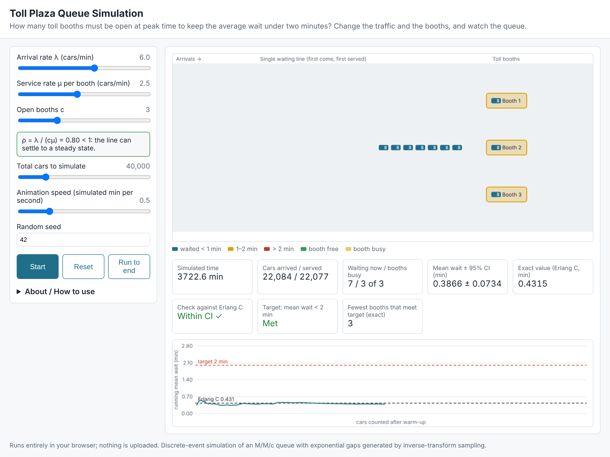
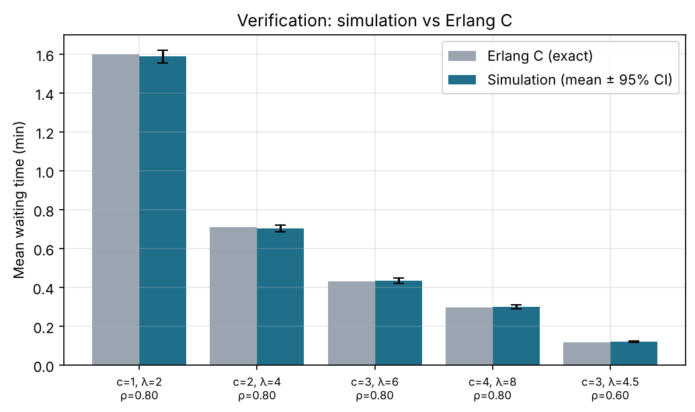
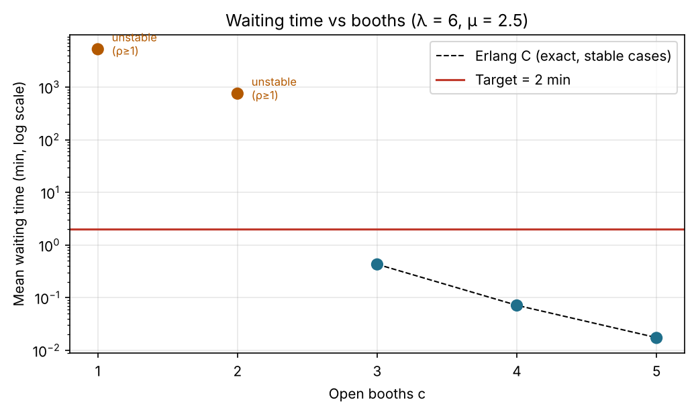

# Toll Plaza Queue Simulation

A discrete-event simulation of an expressway toll plaza that answers one question: **how many booths must be open at peak time to keep the average wait under two minutes?**

**[Live demo](https://kanchan1015.github.io/toll-plaza-mss/)** · [](https://colab.research.google.com/github/Kanchan1015/toll-plaza-mss/blob/main/notebook/toll-plaza-mss.ipynb)



## The problem

At peak time cars reach an expressway toll plaza faster than at any other time. Each open booth serves one car at a time, so if too few booths are open a queue builds up and drivers lose time, while every extra booth costs staff. The operator wants the **smallest number of open booths** that still keeps the average wait in line below two minutes.

The plaza is modelled as an M/M/$c$ queue: cars arrive at random (rate $\lambda$ cars/min), each of $c$ identical booths serves a car in a random time (rate $\mu$ cars/min), and cars share one first-come-first-served line. The example peak values are $\lambda=6$ and $\mu=2.5$; they are placeholders to be replaced by measured values.

## Quick start

**Notebook:** click the *Open in Colab* badge above, then *Runtime → Run all*. Everything runs in about a minute on a free runtime.

**Web demo:** open the [live demo](https://kanchan1015.github.io/toll-plaza-mss/), or download this repository and double-click `docs/index.html`.

**Run locally (optional):**

```bash
pip install -r requirements.txt
jupyter notebook notebook/toll-plaza-mss.ipynb
```

## Using the demo

Move the sliders for arrival rate, service rate and number of booths, press **Start** to watch cars queue and get served (coloured by how long they waited), or **Run to end** to simulate the whole run at once. The page shows the mean wait with a 95% confidence interval next to the exact value, and tells you whether the two-minute target is met. Full guide: [USER_GUIDE.md](USER_GUIDE.md).

## Model and mathematics

With traffic intensity $\rho=\lambda/(c\mu)$, a steady state exists only for $\rho<1$, and the exact mean wait in line is given by the Erlang C formula

$$W_q=\frac{C(c,\lambda/\mu)}{c\mu-\lambda},\qquad C(c,a)=\frac{\frac{a^c}{c!}\frac{1}{1-\rho}}{\sum_{k=0}^{c-1}\frac{a^k}{k!}+\frac{a^c}{c!}\frac{1}{1-\rho}}.$$

The simulator uses next-event time advance with a future-event list, exponential gaps and service times generated by inverse transform ($X=-\ln(1-U)/\text{rate}$), and independent replications with 95% confidence intervals. Full derivations, assumptions and parameters: [THEORY.md](THEORY.md).

## Verification

The simulated mean wait agrees with the exact queueing result within 1.7% in every tested configuration (one to four booths, $\rho=0.6$ and $0.8$), for example **0.436 ± 0.014 min simulated against 0.4315 min exact** for three booths at $\lambda=6$. The notebook enforces this with `assert` statements. Further checks: two independently coded simulators give identical waits for identical random inputs; the 95% interval contains the exact value in 91 of 100 repeated experiments; and the error shrinks like $N^{-1/2}$ (fitted log-log slope $-0.47$).



## Concepts applied

This project applies next-event time-advance discrete-event simulation, inverse-transform random variate generation for exponential interarrival and service times, and Monte Carlo replication with $t$-based confidence intervals. It verifies the simulator against analytic steady-state results (Erlang C and M/M/1), checks the $N^{-1/2}$ convergence of the Monte Carlo error on a log-log plot, generates rush-hour arrivals from a non-homogeneous Poisson process by thinning, and uses common random numbers for a sensitivity analysis.

## Results

At $\lambda=6$ cars/min and $\mu=2.5$ cars/min per booth (30 replications of 40 000 cars, first 5 000 discarded):

| Open booths $c$ | $\rho$ | Simulated mean wait (min, 95% CI) | Exact (Erlang C, min) | Target < 2 min |
|---|---|---|---|---|
| 1 | 2.40 | unstable: queue grows without limit | infinite | no |
| 2 | 1.20 | unstable: queue grows without limit | infinite | no |
| 3 | 0.80 | 0.429 ± 0.009 | 0.4315 | **yes** |
| 4 | 0.60 | 0.0713 ± 0.0013 | 0.0718 | yes |
| 5 | 0.48 | 0.0172 ± 0.0003 | 0.0175 | yes |

**At least 3 booths must be open.** Extensions in the notebook:

- **Rush hour:** with arrivals rising from 2 to 6 cars/min and back, three booths keep the mean wait within 15 minutes of the peak at 0.35 ± 0.04 min; two booths give 4.3 ± 0.3 min. Three booths are still needed.
- **Sensitivity:** the wait depends more on the service rate than on the arrival rate. A 10% fall in $\mu$ raises the three-booth wait by about 147%, while a 10% rise in $\lambda$ raises it by about 102%. The three-booth answer holds for each parameter changed by up to 10% on its own, but a 10% rise in $\lambda$ together with a 10% fall in $\mu$ pushes $\rho$ to 0.98 and four booths are then needed.



## Limitations and future work

- Exponential service times are more variable than real payment times, so waits are somewhat overestimated (the safe side). A general-service (M/G/$c$) model would be the next refinement.
- All booths share one line and are identical; in reality cars choose lanes and some booths are faster than others.
- $\lambda$ and $\mu$ are example values. With measured arrival counts and service times the same notebook gives a decision for a real plaza.

## Key references

1. D. Gross, J. F. Shortle, J. M. Thompson and C. M. Harris, *Fundamentals of Queueing Theory*, 4th ed. Wiley, 2008.
2. A. M. Law, *Simulation Modeling and Analysis*, 5th ed. McGraw-Hill Education, 2015.
3. P. A. W. Lewis and G. S. Shedler, "Simulation of nonhomogeneous Poisson processes by thinning," *Naval Research Logistics Quarterly*, vol. 26, no. 3, pp. 403–413, 1979, doi: 10.1002/nav.3800260304.

Full list: [REFERENCES.md](REFERENCES.md).

## AI assistance

Developed with the help of AI coding and writing assistants. All code was reviewed, run and verified by the author.

## Licence and credits

Code: [MIT](LICENSE). Data: none; the example rates $\lambda$ and $\mu$ are assumed values, and all results are simulated.
