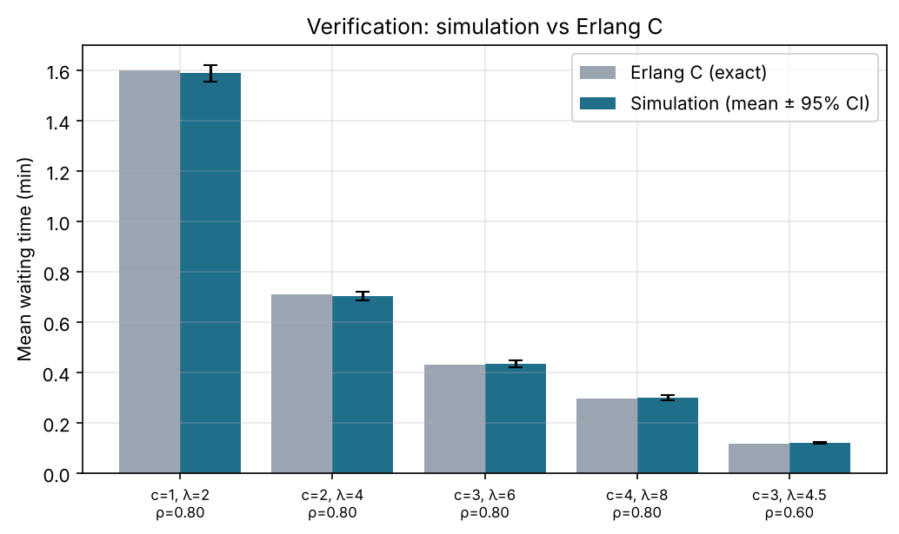
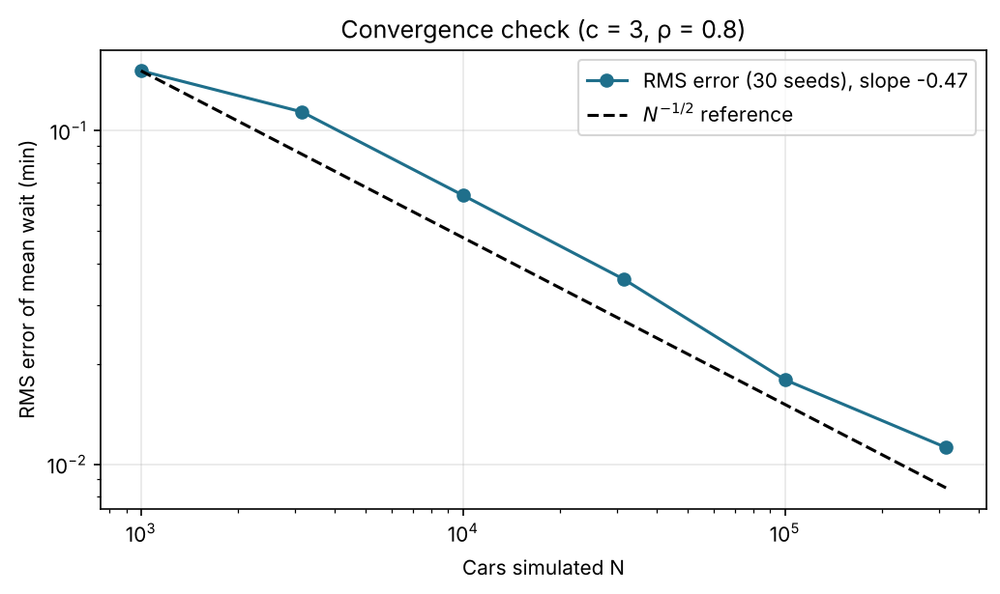

# Theory and mathematics

## 1. Problem formulation

An expressway toll plaza has $c$ identical booths fed by one waiting line. Cars arrive at random, each booth serves one car at a time for a random duration, and cars that find every booth busy wait their turn. The quantity of interest is the **mean waiting time in line** $W_q$ (arrival until service starts), and the question is:

> What is the smallest number of open booths $c$ for which $W_q < 2$ minutes at peak demand?

Peak demand is represented by an arrival rate $\lambda = 6$ cars/min and a per-booth service rate $\mu = 2.5$ cars/min. These are example values, not measurements; every result is recomputed from whatever values are set at the top of the notebook.

## 2. Assumptions

1. **Poisson arrivals** at constant rate $\lambda$ (peak value). Cars choose their arrival times independently, so gaps are exponential. Reasonable over a short, stable peak period; relaxed in extension X3.
2. **Exponential service times** with mean $1/\mu$, independent of arrivals and of each other. This is a simplification: real payment times are less variable, so the model tends to overestimate waits (safe side).
3. **One shared first-come-first-served line** feeding $c$ identical booths. Cars do not switch lines, balk or leave.
4. **Unlimited waiting space**, so no car is turned away.
5. **Waiting time** excludes the service itself.

These assumptions define the **M/M/$c$ queue** (M/M/1 when $c=1$).

## 3. Model equations

**Traffic intensity and stability.** With offered load $a=\lambda/\mu$,

$$\rho=\frac{\lambda}{c\,\mu}=\frac{a}{c}.$$

A steady state exists only if $\rho<1$. If $\rho\ge 1$ the queue grows without limit.

**Exact steady-state result (Erlang C).** Let $N$ be the number of cars in the system. It changes by $+1$ at rate $\lambda$ and by $-1$ at rate $\min(N,c)\,\mu$, which gives the balance equations whose solution is

$$p_n=\begin{cases}p_0\,\dfrac{a^{n}}{n!}, & 0\le n\le c,\\[2mm] p_0\,\dfrac{a^{n}}{c!\,c^{\,n-c}}, & n\ge c,\end{cases}\qquad
p_0^{-1}=\sum_{k=0}^{c-1}\frac{a^{k}}{k!}+\frac{a^{c}}{c!\,(1-\rho)}.$$

Because Poisson arrivals see the system as it is on average, the probability that an arriving car must wait equals $P(N\ge c)$:

$$C(c,a)=\sum_{n\ge c}p_n=\frac{\dfrac{a^{c}}{c!}\,\dfrac{1}{1-\rho}}{\displaystyle\sum_{k=0}^{c-1}\frac{a^{k}}{k!}+\frac{a^{c}}{c!}\,\frac{1}{1-\rho}}.$$

The mean number waiting is $L_q=\sum_{n>c}(n-c)p_n=C\,\dfrac{\rho}{1-\rho}$, and Little's law $L_q=\lambda W_q$ gives

$$\boxed{W_q=\frac{C(c,a)}{c\mu-\lambda}}\qquad(\rho<1).$$

For $c=1$, $C=\rho$ and $W_q=\dfrac{\rho}{\mu-\lambda}$, the M/M/1 closed form used as an independent check. At the example values with $c=3$: $a=2.4$, $\rho=0.8$, $C=0.6472$, $W_q=0.4315$ min.

**Random variate generation (inverse transform).** If $U\sim U(0,1)$ and $F(x)=1-e^{-r x}$ is the exponential distribution function with rate $r$, then

$$X=F^{-1}(U)=-\frac{\ln(1-U)}{r}$$

is exponential with rate $r$. Interarrival gaps use $r=\lambda$ and service times use $r=\mu$.

**Rush hour (extension X3).** The constant rate is replaced by a smooth time-varying rate

$$\lambda(t)=\lambda_{\text{base}}+(\lambda_{\text{peak}}-\lambda_{\text{base}})\exp\!\left[-\frac12\left(\frac{t-t_{\text{peak}}}{\sigma}\right)^{2}\right],\qquad 0\le t\le T.$$

Arrivals are generated by **thinning**: simulate a homogeneous Poisson process at the maximum rate $\lambda_{\max}=\lambda_{\text{peak}}$ and keep a candidate at time $t$ with probability $\lambda(t)/\lambda_{\max}$. The surviving times form a non-homogeneous Poisson process with intensity $\lambda(t)$ [5].

**Sensitivity (extension X5).** The elasticity of the wait with respect to a parameter $p$ is

$$\varepsilon_p=\frac{\partial \ln W_q}{\partial \ln p}\approx\frac{\Delta W_q/W_q}{\Delta p/p}.$$

Since $W_q=\dfrac{1}{\mu}\,g(\lambda/\mu)$ for a fixed number of booths, the two elasticities are linked by $\varepsilon_\mu=-1-\varepsilon_\lambda$: the service rate acts once through the load $a$ and once through the time scale $1/\mu$, so $|\varepsilon_\mu|>|\varepsilon_\lambda|$ always.

| Symbol | Meaning | Units | Value / range | Source |
|---|---|---|---|---|
| $\lambda$ | arrival rate at peak | cars/min | 6 (demo: 0.5–10) | example value |
| $\mu$ | service rate of one booth | cars/min | 2.5 (demo: 0.5–5) | example value |
| $c$ | open booths | – | 1–5 (demo: 1–8) | decision variable |
| $a=\lambda/\mu$ | offered load | – | 2.4 | derived |
| $\rho=\lambda/(c\mu)$ | traffic intensity | – | 0.8 for $c=3$ | derived |
| $C(c,a)$ | probability an arriving car waits | – | 0.647 for $c=3$ | Erlang C [1] |
| $W_q$ | mean waiting time in line | min | target < 2 | output |
| $n$ | cars per replication | cars | 40 000 | chosen (§4) |
| $n_w$ | warm-up cars discarded | cars | 5 000 | chosen (§4) |
| $R$ | independent replications | – | 30 | chosen (§4) |
| $\lambda_{\text{base}},\lambda_{\text{peak}}$ | off-peak and peak rate (X3) | cars/min | 2, 6 | example values |
| $t_{\text{peak}},\sigma,T$ | peak time, width, window (X3) | min | 90, 25, 180 | example values |

## 4. Numerical method

**Next-event time advance.** The simulator keeps a clock and a future-event list (a binary heap) that holds the next arrival and one departure for every busy booth. It repeatedly removes the earliest event and jumps the clock to its time. An arrival either starts service immediately (if a booth is free) or joins the line; a departure frees a booth, which immediately takes the car at the head of the line. Nothing is computed between events [3].

**Output analysis.** The system starts empty, which biases early waits downwards, so the first $n_w=5\,000$ cars of each run are discarded. Each scenario is run as $R=30$ independent replications (independent streams from `numpy.random.SeedSequence.spawn`). If $\bar x_r$ is the mean wait of replication $r$, the reported result is

$$\bar x\pm t_{R-1,\,0.975}\,\frac{s}{\sqrt R},$$

where $s$ is the sample standard deviation of the $\bar x_r$ [2]. With the chosen sizes the half-width is about 2% of the mean at $\rho=0.8$.

**Accuracy and stability.** The Monte Carlo error falls as $n^{-1/2}$ (checked in §5). The method is only meaningful for $\rho<1$; for $\rho\ge1$ the waits of a finite run depend on its length and are reported only to demonstrate instability.

**Web demo.** The browser demo uses the same algorithm with one long run instead of replications. Its confidence interval uses non-overlapping batch means: after the warm-up, waits are grouped into batches of 1 000 cars, and a $t$-interval is formed from the batch means once at least 10 batches exist [6]. A single run is noisier than 30 replications, so its interval is wider.

## 5. Verification

All values below are produced by the notebook (seed 42 unless stated). Settings: 30 replications of 40 000 cars, 5 000 discarded.

| Check | Expected | Obtained | Pass? |
|---|---|---|---|
| M/M/1, $\lambda=2$, $\mu=2.5$ ($\rho=0.8$): closed form $\rho/(\mu-\lambda)$ | 1.6000 min | 1.5921 ± 0.0280 (0.49% error) | yes |
| M/M/2, $\lambda=4$: Erlang C | 0.7111 min | 0.7042 ± 0.0177 (0.97%) | yes |
| M/M/3, $\lambda=6$: Erlang C | 0.4315 min | 0.4359 ± 0.0140 (1.03%) | yes |
| M/M/4, $\lambda=8$: Erlang C | 0.2982 min | 0.3008 ± 0.0101 (0.85%) | yes |
| M/M/3, $\lambda=4.5$ ($\rho=0.6$): Erlang C | 0.1182 min | 0.1202 ± 0.0025 (1.63%) | yes |
| Two independently coded simulators, same random inputs | identical waits | identical for $c=1,2,3,5$ | yes |
| Coverage of the 95% interval (100 repeated experiments, $c=3$) | about 95 of 100 | 91 of 100 | yes (≥ 85 required) |
| Error scaling: log-log slope of RMS error against $n$ | $-0.5$ | $-0.47$ | yes |
| Thinning: total arrivals in the rush-hour window | $\int_0^T\lambda(t)\,dt=610.6$ | $609.8\pm2.9$ | yes |
| Thinning: arrivals in each of 18 ten-minute bins | $\int\lambda(t)\,dt$ per bin | max $\lvert z\rvert=2.65$ (limit 4) | yes |
| Sensitivity: elasticity of $W_q$ to $\lambda$ ($\pm5\%$, $c=3$) | $+6.27$ (Erlang C) | $+6.32\pm0.16$ | yes |
| Sensitivity: elasticity of $W_q$ to $\mu$ | $-7.52$ (Erlang C) | $-7.58\pm0.17$ | yes |

The first five rows are enforced with `assert` statements (5% tolerance), so the notebook stops if the simulator ever disagrees with theory. The coverage result of 91 out of 100 is about 1.8 standard deviations below 95 (a count out of 100 has a standard deviation of about 2.2), so it is consistent with chance; the 100 estimates average 0.4303 min against the exact 0.4315 min, so there is no meaningful bias.

## 6. Concepts applied

| Concept | Where it is used in this project |
|---|---|
| Discrete-event simulation with next-event time advance | The M/M/$c$ simulator with a future-event list (notebook §3; demo engine) |
| Random variate generation by inverse transform | Every interarrival gap and service time; thinning candidates (notebook §3, §6.2) |
| Monte Carlo replications and confidence intervals | Mean ± 95% interval on every reported wait (notebook §4–§6); batch-means interval in the demo |
| Verification against analytic results | Erlang C and M/M/1 asserts, independent second implementation, interval-coverage test (notebook §4) |
| Law of large numbers and $n^{-1/2}$ error decay | Log-log convergence check (notebook §6.1) |
| Non-homogeneous Poisson process by thinning | Rush-hour arrivals (notebook §6.2) |
| Sensitivity analysis with common random numbers | Effect of $\lambda$ and $\mu$ on the answer (notebook §6.3) |

## 7. References

See [REFERENCES.md](REFERENCES.md).
