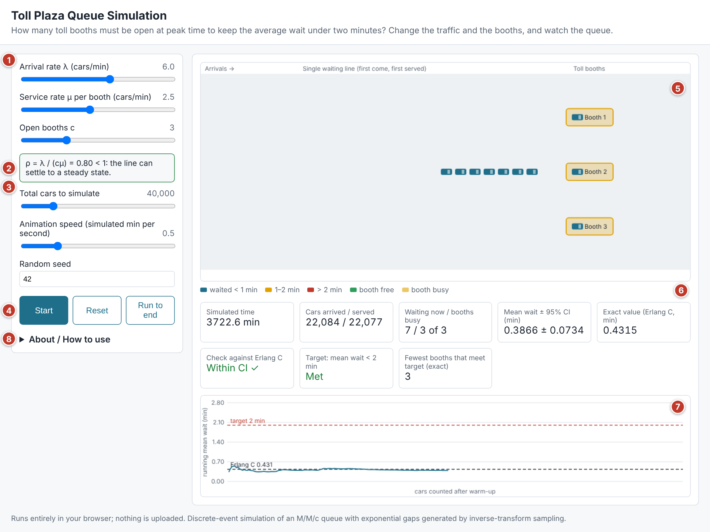

# User guide: Toll Plaza Queue Simulation web demo

**Open the demo:** [https://kanchan1015.github.io/toll-plaza-mss/](https://kanchan1015.github.io/toll-plaza-mss/). It runs entirely in your browser (current Chrome, Edge or Firefox). Nothing is installed or uploaded.

| Label | Part of the page |
|---|---|
| 1 | Traffic and booth sliders ($\lambda$, $\mu$, booths) |
| 2 | Traffic-intensity message ($\rho$) |
| 3 | Run settings (total cars, animation speed, random seed) |
| 4 | Start / Pause, Reset, Run to end |
| 5 | Live animation: waiting line and toll booths |
| 6 | Numerical outputs and the check against theory |
| 7 | Running mean wait compared with the exact value and the 2-minute target |
| 8 | About / How to use panel |

## Controls

| Control | What it does | Range | Default |
|---|---|---|---|
| Arrival rate $\lambda$ | Average number of cars arriving per minute | 0.5–10 cars/min | 6.0 |
| Service rate $\mu$ per booth | Average number of cars one booth can serve per minute (mean service time is $1/\mu$) | 0.5–5 cars/min | 2.5 |
| Open booths $c$ | Number of toll booths serving the single waiting line | 1–8 | 3 |
| Total cars to simulate | Length of the run; the first 12.5% (at most 5 000 cars) are discarded as warm-up | 2 000–200 000 | 40 000 |
| Animation speed | Simulated minutes that pass per real second (affects only how fast it plays, not the result) | 0.1–2 000 | 0.5 |
| Random seed | Starting value of the random numbers; the same seed gives the same run | 1 or more | 42 |
| Start / Pause | Runs or pauses the simulation | — | — |
| Reset | Clears the run and applies the current settings | — | — |
| Run to end | Skips the animation and simulates all remaining cars at once | — | — |

Changing $\lambda$, $\mu$, booths, total cars or the seed resets the run automatically.

## Reading the outputs

- **Animation:** cars arrive from the left, wait in a single line (first come, first served) and are served at the booths on the right. Car colour shows how long it waited: blue under 1 minute, amber 1–2 minutes, red over 2 minutes. Booths are green when free and amber when busy. If the line is longer than the picture can show, a red label counts the extra cars.
- **Traffic-intensity message:** green when $\rho<1$ (the line can settle down), red when $\rho\ge1$ (the booths cannot keep up and the line grows without limit).
- **Mean wait ± 95% CI:** the average time cars spend waiting in line, in minutes, with a 95% confidence interval from batch means. It appears once enough cars have been served; until then it is marked *collecting*.
- **Exact value (Erlang C):** the textbook steady-state mean wait for the current settings, in minutes. It is infinite when $\rho\ge1$.
- **Check against Erlang C:** *Within CI* when the exact value lies inside the interval. A correct simulator will show *Outside CI* roughly once in every 20 runs (a little more often when $\rho$ is close to 1), so try another seed before suspecting a problem. When $\rho\ge1$ no steady state exists and the check is not applicable.
- **Target:** *Met* when the whole interval is below 2 minutes, *Not met* when it is entirely above, *Unclear yet* when it straddles 2 minutes.
- **Fewest booths that meet target:** the smallest number of booths whose exact mean wait is under 2 minutes for the current $\lambda$ and $\mu$.
- **Chart:** the running mean wait (blue) settling towards the exact value (black dashed), with the 2-minute target (red dashed).

## Try this

1. **Reproduce the answer.** Leave the defaults and press **Run to end**. The mean wait comes out at **0.42 ± 0.06 minutes**, inside the interval around the exact value 0.4315, the target shows *Met*, and "fewest booths" shows 3. Press **Start** instead to watch the same run unfold car by car.
2. **Too few booths.** Set booths to 2, so $\rho=1.20$ turns red. Press **Start** with the speed slider near 5 and watch the line fill with red cars. **Run to end** gives a mean wait of about 780 minutes, and it would be longer still for a longer run.
3. **Heavier traffic.** Set $\lambda$ to 10. With 4 booths $\rho=1.00$ is still unstable; with 5 booths **Run to end** gives about **0.24 ± 0.03 minutes** and "fewest booths" shows 5.
4. **Run-to-run variation.** Change the seed and press **Run to end** several times. The estimate moves around the exact value by about as much as the interval says it should.

## Check against the notebook

With the default settings and the default seed, **Run to end** gives **0.42 ± 0.06 minutes**, which matches the notebook result in section 5 (**0.43 ± 0.01 minutes**) and the exact value 0.4315. The demo's interval is wider because it uses one run, whereas the notebook averages 30 independent replications.

## Limitations

- The demo is a single run per press; the notebook averages 30 replications and is the source for the reported results.
- Intervals from a single run become less reliable as $\rho$ approaches 1, where successive waits are strongly correlated and the system takes very long to settle.
- All cars share one line and all booths are identical; service and gaps between cars are exponential (see [THEORY.md](THEORY.md)).
- Time-varying (rush-hour) arrivals, the log-log convergence check and the sensitivity study are in the notebook only.
- At the highest animation speeds cars move faster than the picture can follow; use **Run to end** to read results.
